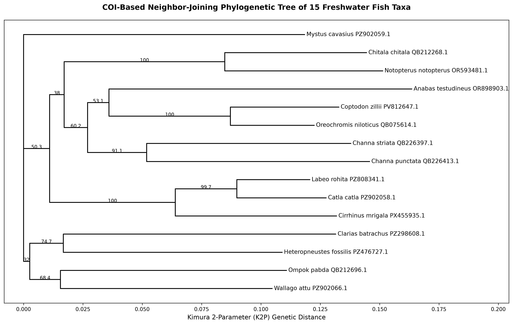

# Fish COI DNA Barcoding and Phylogenetic Analysis

## Project Overview

This project investigates mitochondrial cytochrome c oxidase subunit I (COI) sequence variation and phylogenetic relationships among 15 freshwater fish species occurring in Bangladesh.

The workflow uses publicly available NCBI GenBank sequences and reproducible computational methods for sequence validation, quality assessment, multiple sequence alignment, genetic distance estimation, and phylogenetic reconstruction.

## Objectives

- Retrieve mitochondrial COI sequences from the NCBI Nucleotide Database.
- Verify sequence annotations, gene identity, and organism information.
- Assess sequence quality and coding-region integrity.
- Extract and align COI sequences using MAFFT.
- Identify a common homologous region for comparative analysis.
- Calculate nucleotide composition and pairwise genetic distances.
- Construct a Kimura 2-Parameter (K2P) distance matrix.
- Reconstruct a Neighbor-Joining (NJ) phylogenetic tree.
- Evaluate branch support using 1,000 bootstrap replicates.
- Visualize and interpret phylogenetic relationships among the selected species.

## Dataset

- **Number of species:** 15
- **Molecular marker:** Mitochondrial COI
- **Sequence database:** NCBI GenBank
- **Final aligned region:** 558 bp per species
- **Pairwise comparisons:** 105
- **Phylogenetic method:** Neighbor-Joining
- **Evolutionary distance model:** Kimura 2-Parameter
- **Bootstrap replicates:** 1,000

The selected records represent freshwater fish species occurring in Bangladesh. The sequences were retrieved from GenBank and are not necessarily derived from specimens collected in Bangladesh.

## Workflow

1. **Sequence retrieval:** Download COI GenBank records using accession numbers.
2. **Annotation validation:** Verify organism names, mitochondrial origin, COI gene annotations, and sequence lengths.
3. **Sequence quality assessment:** Examine coding sequences, codon positions, ambiguous nucleotides, internal stop codons, and translation consistency.
4. **COI extraction:** Extract annotated coding regions and generate a FASTA dataset.
5. **Multiple sequence alignment:** Align sequences using MAFFT.
6. **Alignment inspection and trimming:** Identify the shared ungapped region and generate a 558 bp trimmed alignment.
7. **Nucleotide composition:** Calculate A, T, G, and C frequencies and GC content.
8. **Genetic distance analysis:** Calculate pairwise p-distances and K2P distances.
9. **Distance matrix construction:** Generate a symmetric K2P distance matrix.
10. **Phylogenetic reconstruction:** Construct a Neighbor-Joining tree and assess branch support using 1,000 bootstrap replicates.
11. **Visualization:** Render the phylogenetic tree using Python and Matplotlib.

## Tools and Technologies

- **Operating system:** Ubuntu Linux
- **Command-line tools:** Bash
- **Programming language:** Python 3
- **Sequence analysis:** Biopython
- **Multiple sequence alignment:** MAFFT
- **Sequence database:** NCBI GenBank
- **Data visualization:** Matplotlib
- **Version control and portfolio:** GitHub

## Project Structure

```text
fish-coi-barcoding/
│
├── data/
│   ├── raw/
│   ├── processed/
│   └── accessions.csv
│
├── scripts/
│   ├── 01_setup_project.sh
│   ├── 02_download_genbank.sh
│   ├── 03_validate_genbank.py
│   ├── 04_sequence_quality_control.py
│   ├── 05_extract_coi_fasta.py
│   ├── 06_inspect_alignment.py
│   ├── 07_find_common_region.py
│   ├── 08_trim_alignment.py
│   ├── 09_nucleotide_composition.py
│   ├── 10_pairwise_genetic_distances.py
│   ├── 11_create_k2p_matrix.py
│   ├── 12_build_nj_tree.py
│   ├── 13_bootstrap_nj_tree.py
│   └── 14_render_tree.py
│
├── results/
├── figures/
├── docs/
├── logs/
├── .gitignore
└── README.md
```

## Key Outputs

- GenBank annotation validation report
- Sequence quality assessment report
- Extracted COI FASTA dataset
- Multiple sequence alignment
- Trimmed 558 bp alignment
- Nucleotide composition analysis
- Pairwise genetic distance table
- K2P distance matrix
- Neighbor-Joining tree
- Bootstrap-supported phylogenetic tree
- High-resolution phylogenetic tree figure
- ## Phylogenetic Tree

The Neighbor-Joining tree was reconstructed using Kimura 2-Parameter genetic distances and evaluated with 1,000 bootstrap replicates.



## Reproducibility

The project is organized around reusable Bash and Python scripts. Each major analytical step is implemented as a separate script to support reproducibility, transparency, and easier workflow management.

Raw GenBank records, processed sequence files, analysis outputs, and visualization files are organized into separate directories.

## Project Status

**Core computational workflow completed.**

Sequence retrieval, annotation validation, sequence quality assessment, COI extraction, alignment, trimming, nucleotide composition analysis, genetic distance estimation, Neighbor-Joining reconstruction, and bootstrap analysis have been completed.

Further biological interpretation, documentation, and project refinement are ongoing.

## Limitations

- The analysis is based on a single mitochondrial marker (COI).
- Publicly available database records may vary in sequence length and geographic origin.
- Phylogenetic relationships inferred from COI should not be interpreted as a complete species-level evolutionary history.
- Bootstrap support reflects the stability of inferred branches under site resampling, not absolute certainty.

## Data Source

NCBI Nucleotide Database: https://www.ncbi.nlm.nih.gov/nuccore/

Individual accession numbers are documented in `data/accessions.csv`.
